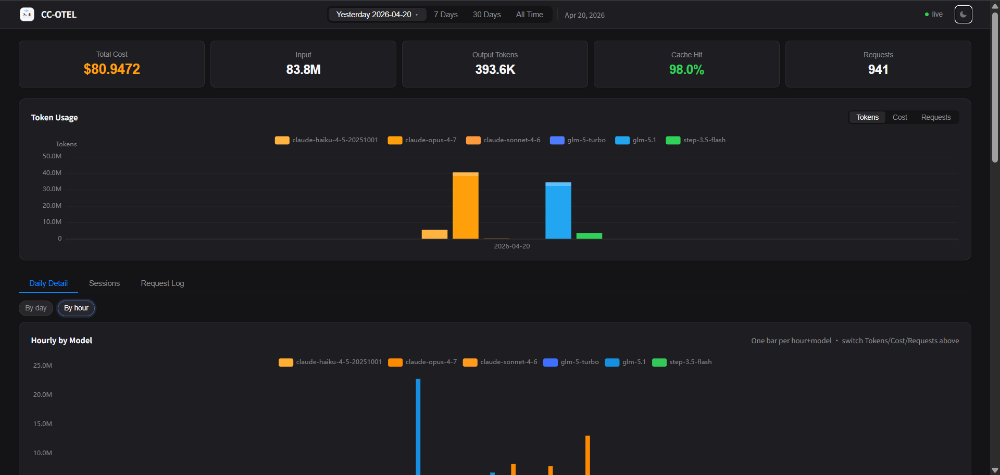
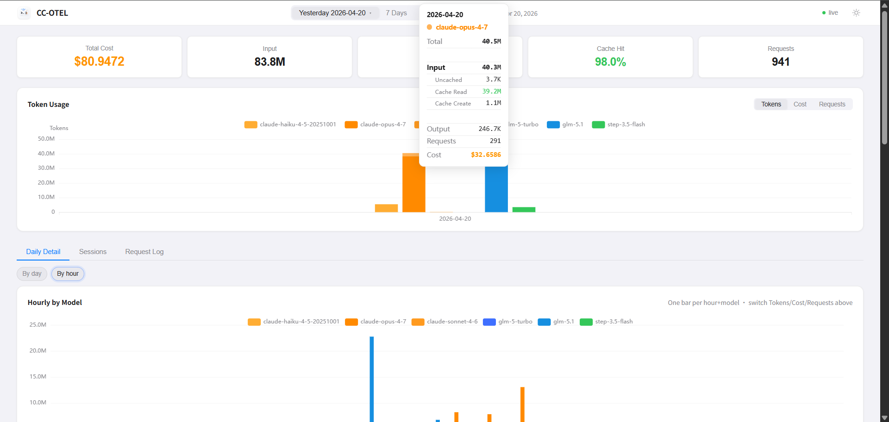

[English Documentation](./README_en-US.md)

[](https://github.com/young1lin/cc-otel)
[](https://golang.org/)
[](LICENSE)
[](https://github.com/young1lin/cc-otel/releases)
[](https://codecov.io/gh/young1lin/cc-otel)
[](https://goreportcard.com/report/github.com/young1lin/cc-otel)
[](https://github.com/young1lin/cc-otel/actions/workflows/test.yml)
[](https://github.com/young1lin/cc-otel/releases)
[](https://github.com/young1lin/cc-otel/releases)

# CC-OTEL

多客户端 LLM Token 用量监控服务。接收 OTEL 遥测数据（Claude Code / Codex / opencode / DeepSeek Harness），提供 Web 仪表盘查看 token 消耗和费用。多个客户端共享同一个 cc-otel 实例，仪表盘按来源区分。

## 文档

- [设计说明（为什么这样做 / 怎么改最合适）](./docs/DESIGN.md)
- [更新日志（版本变更）](./CHANGELOG.md)
- [Claude Code OTEL 事件参考](./docs/otel-events.md)

**Dark**


**Light**


## 为什么需要

Claude Code / Codex / opencode / DeepSeek Harness 都内置了 OpenTelemetry 支持，但查看数据需要搭建 Grafana、Prometheus 或使用第三方 SaaS。**CC-OTEL** 是一个单二进制文件，接收 OTLP 遥测数据，存储到 SQLite，提供 Web 仪表盘 -- 无外部依赖，零配置即可运行。

## 架构

```
Claude Code / Codex ──OTLP gRPC(:4317)──┐
                                        ├──> cc-otel ──> SQLite
opencode / DSH ──OTLP/HTTP(:4318)───────┘        |
                                            Web UI <── Browser (localhost:8899)
```

## 功能

- **多客户端接入** -- Claude Code / Codex / opencode / DeepSeek Harness 共用一个实例，按来源归因（见下表）
- **OTLP 双传输接收器** -- gRPC（`:4317`）+ OTLP/HTTP（`:4318`），同一套入库逻辑
- **Web 仪表盘** -- Token 用量、费用明细、缓存命中率、按模型统计
- **KPI 分项** -- 点击任意 KPI 卡片查看模型级别明细
- **实时更新** -- SSE 推送，新数据到达时自动刷新
- **深色/浅色主题** -- 自动跟随系统偏好
- **日期范围** -- Today、7 Days、30 Days、All Time，或自定义日期
- **图表切换** -- Tokens、Cost、Requests 视图
- **会话追踪** -- 按会话聚合费用和 Token
- **客户端汇总（Clients）** -- 按 OTLP `service.name` 统计各客户端的 Token / 成本 / 请求数 / 命中率（直读永不清理的 `api_requests` 台账，历史全量）
- **Hour of Day 时间段透视** -- 整个区间折叠成 24 个「几点钟」桶，客户端 × 模型双维度下钻：锁模型看「谁在烧」、锁客户端看「在烧什么」、都锁看单序列明细
- **分页跳页** -- 长表格（Request Log 等）输入页码直达任意页
- **Token 速率图（Rate）** -- 按模型查看 Out/Total tok/s 随时间变化（加权 / 平均、5–60 min 桶；最长 7 天）
- **在线数据库导入** -- 上传 `.db` 合并进运行中的主库，不停进程、只增不改
- **预聚合表** -- 查询延迟 < 3ms，百万行无压力
- **单二进制** -- `go:embed` 打包 Web UI，零运行时依赖
- **跨平台** -- Windows、macOS、Linux

## 支持的客户端

| 客户端 | 传输 / 端口 | 接入方式 | 详细文档 |
|--------|------------|----------|----------|
| **Claude Code** | OTLP gRPC `:4317` | `~/.claude/settings.json` 加 OTEL 环境变量（`/cc-otel:setup` 一键完成） | [下文](#配置客户端) |
| **Codex CLI** | OTLP gRPC `:4317` | `~/.codex/config.toml` 加 `[otel]` 段 | [下文](#codex-cli-接入) |
| **opencode** | OTLP/HTTP `:4318` | `opencode.jsonc` 开关 + `OTEL_EXPORTER_OTLP_ENDPOINT` 环境变量 | [下文](#opencode-接入) |
| **DeepSeek Harness** | OTLP/HTTP `:4318` | npm 插件（推荐）：`dsh plugin --profile web add @young1lin/dsh-cc-otel`；或 `DSH_TELEMETRY_*` 环境变量 / `cordis.patch.yml` 手工接入 | [下文](#deepseek-harness-dsh-接入) |

- 所有客户端共用同一个 cc-otel 实例，数据统一落到仪表盘；请求日志的 **Source 列**逐行标注来源。
- Codex 的历史存档（`codex_*` 表）通过一键迁移并入统一池；新上报在接收侧直接归一化写入 `api_requests`（`service_name='codex'`）。仪表盘是**单一统一视图**：KPI、图表、Sessions、Request Log、Clients、Hour of Day、Rate 全部覆盖**所有客户端**（Codex 含在内），Request Log 的 **Source 列**与 Clients 面板按 `service.name` 标注来源。旧的 `?source=` URL 参数已无意义，访问时会被静默改写为普通 URL。
- 新客户端接入调试：`go run ./tools/otlp_dump`（双传输、只打印不落库，AI SDK span 还会打印 cc-otel 将派生的 `would_store_api_request`）。

## 安装

### Claude Code 插件（推荐）

```bash
/plugin marketplace add young1lin/claude-token-monitor
/plugin install cc-otel@claude-token-monitor
/reload-plugins
/cc-otel:setup
```

### 可用命令

| 命令 | 说明 |
|------|------|
| `/cc-otel:setup` | 下载二进制、配置 OTEL 环境变量、启动服务 |
| `/cc-otel:start` | 启动后台守护进程 |
| `/cc-otel:stop` | 停止守护进程 |
| `/cc-otel:status` | 查看服务状态 + 今日费用摘要 |
| `/cc-otel:open` | 在浏览器中打开 Web 仪表盘 |
| `/cc-otel:report [today\|7d\|30d\|all]` | 生成费用报告 |

### DeepSeek Harness 插件（npm）

```bash
dsh plugin --profile web add @young1lin/dsh-cc-otel
```

一条命令完成接入（`web` 可换成任意 profile：`tui` / `headless` / 自定义）。`dsh plugin` 是 pnpm 转发器，安装时会：

1. 通过 optionalDependencies 自动挑一个平台二进制包（`@young1lin/cc-otel-{linux,darwin,win32}-{x64,arm64}` 之一，与 OS/CPU 匹配）；
2. **遥测 adapter 持续上报**——运行时插件挂一个透明的 `llm/stream` 监听，每次 provider 调用 settle 后把用量（in/out/cacheRead/cacheWrite）、时长、**首字延迟（TTFT）**组一条 OTLP `api_request` 记录实时推给本地 cc-otel；只上报数字，**不含任何提示词或工具输出**，失败即丢、绝不影响模型调用。bundle 的 patch 同时把原生 `session-telemetry-otel` 钉在 `DISABLED`（dsh 0.1.5 移除了 `FULL`，原生反馈触发的整段前缀导出会与 adapter 双计）；
3. profile 启动时由运行时插件把二进制版本对齐到 `~/.cc-otel/`（与 Claude Code 插件共享同一守护进程）并幂等拉起服务。

`CC_OTEL_OTLP_URL` 可重定向 adapter 上报端点；`DSH_TELEMETRY_MODE` / `DSH_TELEMETRY_OTLP_URL` / `DSH_TELEMETRY_DISABLED` 管的是原生导出路径。更新与卸载用 `dsh plugin --profile web update|remove @young1lin/dsh-cc-otel`。详见[包内文档](./npm/dsh-cc-otel/README.md)与[发布说明](./npm/README.md)。

> **隐私**：adapter 每次调用只上报用量与计时数字——没有提示词、没有消息内容、没有工具输出，流量不出 localhost。原生 `FEEDBACK_ONLY` 路径（bundle 默认关闭）在显式反馈时会上传该会话完整前缀，cc-otel 同样只保存 token/费用、不落库正文。

### 从源码编译

```bash
# Linux / macOS
go build -o cc-otel ./cmd/cc-otel/

# Windows
go build -o cc-otel.exe ./cmd/cc-otel/
```

### 从 Release 下载

前往 [Releases](https://github.com/young1lin/cc-otel/releases) 下载对应平台的二进制文件。

### 安装到 ~/.cc-otel/

```bash
cc-otel install    # 复制二进制到 ~/.cc-otel/（全平台通用）
cc-otel init       # 生成默认配置文件
```

> **从旧版本升级（~/.claude/cc-otel/ → ~/.cc-otel/）**：v0.1.0 起安装目录独立于 Claude Code。
> 新二进制首次运行时会**自动**把整个 `~/.claude/cc-otel/`（配置、数据库、日志）迁移到 `~/.cc-otel/`，
> 前提是旧 daemon 已停止（文件被占用时迁移会跳过并在下次重试，数据绝不会被遗弃）。
> 升级步骤：`cc-otel stop`（旧二进制）→ 用新二进制 `cc-otel install && cc-otel start`。

## 运行

```bash
cc-otel start      # 后台启动
cc-otel status     # 查看状态（版本、PID、端口、今日统计）
cc-otel stop       # 停止
cc-otel serve      # 前台运行（调试用）
cc-otel -v         # 输出版本号
cc-otel cleanup    # 按 retention_days 清理旧数据
```

打开仪表盘: **http://localhost:8899/**

## 原理

### 什么是 OpenTelemetry？

[OpenTelemetry](https://opentelemetry.io/)（OTEL）是 CNCF 的可观测性标准，统一了三类遥测信号：

- **Metrics** -- 时序指标（token 数、费用、请求数等）
- **Logs / Events** -- 结构化事件（每次 API 请求、用户 prompt、工具调用结果）
- **Traces** -- 分布式追踪（Claude Code 0.2.x+ 的 beta 功能）

Claude Code 内置 OTEL SDK，通过 **OTLP**（OpenTelemetry Protocol，标准传输协议）把上述信号导出到任意兼容的后端。CC-OTEL 就是一个专门针对 Claude Code 定制的轻量 OTLP 后端。

### 数据流

```
┌─────────────────┐   OTLP/gRPC :4317 ┌──────────────────────┐    ┌────────────────────────┐
│  Claude Code    │ ────────────────▶ │  cc-otel             │───▶│  SQLite                │
│  Codex CLI      │                   │  · gRPC :4317        │    │  · api_requests        │
└─────────────────┘                   │  · OTLP/HTTP :4318   │    │  · codex_api_requests  │
┌─────────────────┐   OTLP/HTTP :4318 │    (同一套 Export)    │    │  · daily_model_agg     │
│  opencode       │ ────────────────▶ │  · LogsService       │    └──────────┬─────────────┘
│  DeepSeek Harness│                  │  · MetricsService    │               │
│  (OTEL SDK)     │                   │  · TraceService      │               │
└─────────────────┘                   └──────────┬───────────┘               │
                                                 │ Notify()                  │
                                                 ▼                           │
                                      ┌──────────────────────┐               │
                                      │  Web UI (:8899)      │◀──────────────┘
                                      │  · REST API          │   query
                                      │  · SSE /api/events   │───┐
                                      └──────────────────────┘   │ push
                                                                 ▼
                                                          ┌────────────┐
                                                          │  Browser   │
                                                          └────────────┘
```

### 三个阶段

**1. 接收（`internal/receiver/`）**

内嵌一个 gRPC 服务器，实现 OTLP 官方定义的 `LogsService`、`MetricsService` 和 `TraceService`：

- 每个 `claude_code.api_request` 日志事件携带一次 API 调用的完整信息（model、tokens、cost、duration、session.id、user.id 等 resource + record attributes），被落库到 `api_requests` 表。
- `claude_code.token.usage`、`claude_code.cost.usage` 等 Metrics 接收时被显式跳过持久化（与 `api_request` log 数据冗余），仅用于不让客户端报错。
- Trace span 用于抽取 `ttft_ms` 并回填到统一池 `api_requests` 的对应列；codex 的 `turn_ttft` 事件走同样的列（见下）。
- **历史自动导入 + 30 天清理**：daemon 启动时（服务器绑定前、单写者窗口内）自动把 `codex_*` 冻结归档经标准迁移引擎导入统一池，并以精确行号区间记录（`codex_auto_import_ranges`）；已手动迁移过的库走零成本快路径（只记 marker 不重导，避免复活被剪枝的子事件行）。导入 **30 天后**自动删除这些区间、重建聚合、marker 置 purged——归档本体永不触碰，之后不再自动导入（手动按钮仍可主动重导）。
- **导入弹窗支持历史 Codex 备份**：上传文件含 `codex_*` 归档时，现代文件在通用导入后追加归档映射；统一表结构过老（pre-AllClient）的 legacy 文件整体路由到 codex→统一映射（预览带 legacy 警告）。归档缺列自动以类型化常量补齐（古老 `tool_tokens` 拼写自动别名），token 归一化与在线路径一致，幂等可重跑。
- `codex.turn_ttft`（回合级首输出时延）直接建模：对同（conversation, model）事件时间之前最新的零 TTFT 锚点行做**只填不清**的 `ttft_ms` 回填 —— completion 自带的 `ttft_ms` 是 Option（非流式/瞬时响应缺省），该事件常常是唯一的 TTFT 来源；权威 completion 带 ttft 时仍以后者为准。还会把 `codex_raw_otlp_events` 的历史行复制进来（同样受 TTL 约束）。`codex_raw_otlp_events` 是合并前的冻结存档，**无任何写入者**，仅由迁移读取。两者 schema 兼容已有 backfill 工具。

**2. 存储（`internal/db/`）**

SQLite（WAL 模式 + `busy_timeout`）单文件数据库：

- `api_requests` / `codex_api_requests` -- 每次 API 调用一行，是最小粒度的原始事实表
- `daily_model_agg` -- 按（日期 × 模型 × 客户端）在写入路径上同步刷新的预聚合表（典型刷新延迟 < 3 ms），Web UI 的图表和 Daily Detail 都查这一张（`service_name` 区分客户端）；`codex_daily_model_agg` 是合并前的 codex 旧存档，不再更新
- `raw_otlp_events` -- 原始事件回溯表 + 后台扫除：`raw_ttl_days`（默认 5 天）按小时清理；`codex_raw_otlp_events` 是归档表，**不参与** TTL 清理（迁移依赖其冻结语义）；其余明细表归 `retention_days`（默认 90 天）管。

Token 统计严格按照 Anthropic 的 [Prompt caching 官方口径](https://docs.anthropic.com/en/docs/build-with-claude/prompt-caching)：输入侧总和 = `input_tokens` + `cache_read_tokens` + `cache_creation_tokens`，三者在 UI 上以「Uncached / Cache Read / Cache Create」三列分项展示。

**3. 展示（`internal/api/` + `internal/web/`）**

- REST API：`/api/dashboard`、`/api/daily`、`/api/sessions`、`/api/rate`、`/api/session/rate`、`/api/status` 等
- SSE：`/api/events` — 接收器每次成功入库新数据后调用 `Broker.Notify()`，通过 Server-Sent Events 推送到浏览器，前端自动刷新图表
- 静态资源：默认通过 `go:embed` 打进二进制；本地开发可用 `CC_OTEL_STATIC_DIR` 从磁盘读取，免重编译

### 双传输：gRPC `:4317` + OTLP/HTTP `:4318`

两种传输走**同一套** Export 入库逻辑（`internal/receiver/http.go` 是协议 shim，不是第二条摄入路径），来源路由、成本重算、去重、SSE 完全一致：

- **gRPC（`:4317`）** -- Claude Code、Codex。Claude Code 对 gRPC 路径优化最多，protobuf 编码比 JSON 小 ~40%，HTTP/2 多路复用降低导出延迟。
- **OTLP/HTTP（`:4318`）** -- 不能说 gRPC 的客户端：opencode 和其他 Vercel AI SDK 应用、DeepSeek Harness（gzip 压缩自动解压）。

shim 严格按 OTLP 规范应答：以客户端发来的编码回应（JSON 进 JSON 出），**没有存下的数据绝不返回 2xx**——exporter 把 2xx 视为已送达并丢弃批次。

## 配置客户端

Claude Code 需要通过 gRPC 导出 OTLP 数据到 CC-OTEL。在 `~/.claude/settings.json` 的 `"env"` 中添加以下环境变量：

```json
{
  "env": {
    "CLAUDE_CODE_ENABLE_TELEMETRY": "1",
    "OTEL_EXPORTER_OTLP_PROTOCOL": "grpc",
    "OTEL_EXPORTER_OTLP_ENDPOINT": "http://localhost:4317",
    "OTEL_METRICS_EXPORTER": "otlp",
    "OTEL_LOGS_EXPORTER": "otlp",
    "no_proxy": "localhost,127.0.0.1"
  }
}
```

> **注意**: 只添加/更新以上 OTEL 相关的 key，不要覆盖已有配置。端口号应与 `cc-otel.yaml` 中的 `otel_port` 一致。

> **⚠️ 代理用户必看**: 如果你设置了 `http_proxy` / `https_proxy`（如 Clash、V2Ray 等代理工具），**必须**同时设置 `no_proxy` 排除 localhost，**否则遥测数据完全收不到**。OTEL gRPC SDK 会把发往 `localhost:4317` 的流量也走代理，代理无法处理 gRPC 导致连接静默失败，cc-otel 收不到任何数据。设置 `"no_proxy": "localhost,127.0.0.1"` 即可让 OTEL exporter 直连本地。`/cc-otel:setup` 会自动添加此项。

### Codex CLI 接入

cc-otel 也支持接收 OpenAI Codex CLI 的 OTEL 遥测数据。Codex 与 Claude Code 共用 OTLP gRPC 端口 (`:4317`)，cc-otel 通过 OTLP Resource 的 `service.name` 字段自动识别来源，并把 Codex 的请求行写入与 Claude Code **同一个统一池**（`api_requests` / `daily_model_agg`，`service_name='codex'` 区分）；旧的 `codex_*` 表是合并前的只读历史存档，用“一键迁移”并入统一池。

在 `~/.codex/config.toml` 中加入（备份后追加，不要覆盖已有配置）：

```toml
[otel]
environment = "dev"
exporter.otlp-grpc.endpoint = "http://localhost:4317"
trace-exporter.otlp-grpc.endpoint = "http://localhost:4317"
metrics-exporter.otlp-grpc.endpoint = "http://localhost:4317"
```

启动 Codex，正常使用即可。打开 dashboard (`http://localhost:8899`)，Codex 的用量（含迁移历史与新上报）与 Claude Code、OpenCode 同页展示——Request Log 的 **Source 列**标注 `codex`，Clients 面板有 codex 一行。上面的 `environment = "dev"` 会作为 OTLP Resource 属性 `env` 上报，cc-otel 将其写入与 Claude Code `user.id` 相同的字段——Request Log 的 **User 列**由此区分 `dev` / `company` / `staging` / `prod` 环境。**Codex 不上报 `cost_usd`**——cc-otel 会用本地价目表按 token 数自动算出费用并写入统一池的 `cost_usd`，Cost KPI 与 Claude 行等同。

### opencode 接入

opencode 基于 Vercel AI SDK，用量上报在 GenAI **span** 上而非日志事件。cc-otel 会把 usage span 重塑成标准 `api_request` 形态，数据进入统一视图，请求日志 Source 列显示 `opencode`。

opencode 说 **OTLP/HTTP（`:4318`）**，指到 `:4317` 不通。两步配置：

**1. 打开遥测开关**（`~/.config/opencode/opencode.jsonc`，Windows 为 `%USERPROFILE%\.config\opencode\opencode.jsonc`）：

```jsonc
{
  "$schema": "https://opencode.ai/config.json",
  "experimental": {
    "openTelemetry": true
  }
}
```

**2. 指向 cc-otel**（标准 OTel 环境变量，用户级持久化）：

```powershell
# Windows
[Environment]::SetEnvironmentVariable('OTEL_EXPORTER_OTLP_ENDPOINT','http://localhost:4318','User')
```

```bash
# macOS / Linux（写进 shell profile）
export OTEL_EXPORTER_OTLP_ENDPOINT=http://localhost:4318
```

> **必须写 base url，不要带 `/v1/traces`**——SDK 会自己拼接信号路径，写全路径会变成 `/v1/traces/v1/traces` 导致 404。

重启 opencode 跑一轮对话，dashboard 的 Source 列应出现 `opencode`。

**与 Claude Code 的差异**：

- opencode **不上报 `cost_usd`**，cc-otel 始终用本地价目表重算；如果通过 opencode 驱动 Claude 模型，需自己在价目表补 Claude 条目（内置快照刻意不含 Claude），否则这些行计 $0。
- usage 只取叶子 span（`ai.streamText.doStream` / `ai.generateText.doGenerate`），父 span 同样带 usage 但会被忽略——两边都算会翻倍。
- `request_id` 用 hex span id，exporter 重试天然幂等。

### DeepSeek Harness (DSH) 接入

cc-otel 也支持接收 [DeepSeek Harness](https://github.com/deepseek-ai/deepseek-harness) 的 session telemetry。与 Claude Code / Codex 不同的两点：

- **走 OTLP/HTTP（`:4318`），不是 gRPC。** DSH 用的是 OTel JS SDK 的 HTTP log exporter，端点必须写**完整的 logs 路径** `/v1/logs`，而不是只写主机端口。
- **DSH 上报的是整份 session 账本**（每一条 user/assistant 消息、工具调用、工具结果）。cc-otel 只把带 `usage` 的 `assistant/message` 转成 `api_requests` 一行，其余记录**一律丢弃不落库**——因为反馈触发的全量上传里它们包含完整的提示词、命令输出和文件内容。

DSH 的 `dsh-base` bundle 已经内置了 `session-telemetry-otel` 这一行，默认 `DISABLED` 且指向 DeepSeek 官方 collector。改成本地 cc-otel 有三种方式。

**方式〇：npm 插件（推荐，一条命令）**

```bash
dsh plugin --profile web add @young1lin/dsh-cc-otel
```

插件自动完成三件事：挂遥测 adapter 实时上报每次调用的用量与计时（0.1.5 移除 `FULL` 后这就是持续统计的来源）、把原生遥测行钉在 `DISABLED`、并在 profile 启动时保活守护进程（二进制随包按平台分发）。详见[安装章节](#deepseek-harness-插件npm)。

以下手工方式适合不想装包、或需要完全手控的场景——用户 patch 层优先级高于插件 bundle 层，两种方式也可共存。

**方式一：环境变量（临时，单个 shell 生效）**

```powershell
$env:DSH_TELEMETRY_MODE = "FEEDBACK_ONLY"
$env:DSH_TELEMETRY_OTLP_URL = "http://localhost:4318/v1/logs"
npx @deepseek-ai/dsh web
```

**方式二：写进 `$DSH_HOME/cordis.patch.yml`（永久，推荐）**

`$DSH_HOME` 默认是 `~/.dsh`。在该文件里追加下面这一条顶层记录（**不要**放进已有的 `insert:` 列表里——它是按 `id` 覆盖 bundle 已有行，不是新增行）：

```yaml
- id: session-telemetry-otel
  name: '@deepseek-ai/dsh-session-telemetry-otel'
  config:
    mode: !!js process.env.DSH_TELEMETRY_MODE || 'FEEDBACK_ONLY'
    shutdownTimeoutMillis: 3000
    exporter:
      url: !!js process.env.DSH_TELEMETRY_OTLP_URL ?? 'http://localhost:4318/v1/logs'
      compression: gzip
      timeoutMillis: 1000
    processor:
      scheduledDelayMillis: 10000
      maxQueueSize: 2048
      maxExportBatchSize: 2048
      exportTimeoutMillis: 1500
```

> **注意**: patch 是**整键替换**而非深合并，所以 bundle 原本设置的每个字段都要在这里重新写全，漏掉哪个就会退回插件默认值。`name` 建议保留：DSH 若改包名，这条 patch 会带警告跳过，而不是静默把遥测发回官方 collector。上面两个 `!!js` 保留了环境变量覆盖能力（例如 `DSH_TELEMETRY_OTLP_URL=http://localhost:14318/v1/logs` 可临时指向 dev 实例）。

改完用 `npx @deepseek-ai/dsh web --dump-config` 确认合成结果：应当只出现**一行** `id: session-telemetry-otel`，且 URL 已是本地地址。

启动 DSH 正常对话即可。dsh 0.1.5 起 `FEEDBACK_ONLY` 下普通对话**不会自动上报**：对某条回复点 👍/👎 或运行 `/feedback`，该会话的完整前缀（seq 0 到反馈事件）会一次性上传；持续统计用 `go run ./tools/dsh_ingest -db ~/.cc-otel/cc-otel.db` 从本地会话日志补录（幂等，可重跑）。dashboard (`http://localhost:8899`) 的 Source 列会显示 `deepseek-harness`。

**排查清单**（按出现频率排序）：

| 现象 | 原因 |
|------|------|
| 对话了但没数据 | 预期行为：0.1.5 起 `FEEDBACK_ONLY` 下普通对话零上报，只有显式反馈触发一次上传；持续统计用 `tools/dsh_ingest` 补录 |
| 启动报 `mode expected "FEEDBACK_ONLY" \| "DISABLED" but got "FULL"` | dsh 0.1.5 移除了 `FULL` 模式——配置里删掉它（本仓库所有示例已改） |
| 完全没数据 | patch 未生效时 `mode` 默认是 `DISABLED`；配置在插件加载时读取，改完**必须重启 dsh** |
| 完全没数据，且配置无误 | `DSH_TELEMETRY_DISABLED` 只要非空（含 `0` / `false`）就一票否决 |
| 等了几秒还没出现 | 批处理 `scheduledDelayMillis: 10000`，最多延迟 10 秒才导出 |
| 只收到最近几条，历史对话没有 | DSH 只从 telemetry 启用时的 live 边界开始交接，之前的历史事件不会补发（`tools/dsh_ingest` 可从本地日志补全） |
| 费用是 $0 | 该模型没有价格条目（如 `glm-5.x` 上游价目表尚未收录），需在 Pricing Table 手动添加后点 ↻ 重算历史 |
| 服务端报 `malformed OTLP payload` | cc-otel 版本过旧：DSH 默认 `compression: gzip`，需要 v0.1.0+ 才会解压 |

> **⚠️ 隐私**: 显式反馈触发的上传会把完整会话内容（提示词、工具输出、文件内容）发到上面配置的端点。cc-otel 只保存 token 与费用、不落库任何正文（`raw_otlp_events` 也为空），但数据确实经过了这个连接——请保持指向 localhost。`tools/dsh_ingest` 补录只读本机文件，数据不出本机。

## 价格表与非 Claude 模型重算

cc-otel 内嵌了从 [BerriAI/litellm](https://github.com/BerriAI/litellm) 派生的价格快照（GPT / GLM / DeepSeek / Kimi / Qwen …），首次启动会写入 `model_pricing` 表。**价目表纯手动维护，不再定时拉远端**，运行时按以下顺序选价：

1. **`cc-otel.yaml` 的 `pricing:`**（用户覆盖，最高优先级）
2. **SQLite `model_pricing` 表**（长期存储 + 跨重启）

要改价：打开 Web UI（右上角 `live` → 状态弹窗 → **Pricing Table**）直接增删改查，保存即时生效；也可点行内 💡 按需从 OpenRouter 单模型查询并回填。改完价后可用 ↻ 重算历史 触发服务端全量回填（状态留存，刷新页面不重算）。

写入逻辑只有一条规则：

- `model` 以 `claude-` 开头（大小写不敏感）→ 信任 Claude Code 上报的 `cost_usd`，不动。
- 其他全部模型 → 按本地价目表用 token 数重算并覆盖。

派生效果：Codex (`gpt-5-codex` 等)、GLM/DeepSeek/Kimi 走 Anthropic 兼容反代时上报的 `cost_usd` 都会被纠正。

调试：访问 `GET /api/pricing/lookup?model=glm-4.6` 查看命中策略与价格；状态弹窗的 Pricing Table 行展示上次重算结果。

历史回填：

```bash
# dry-run
go run ./tools/recompute_cost --db ~/.cc-otel/cc-otel.db --table both
# 确认 diff 合理后再 --apply
go run ./tools/recompute_cost --db ~/.cc-otel/cc-otel.db --table both --apply
```

## 在线数据库导入

运行中的服务可直接合并一个 `.db` 文件到主库——**不停进程、不替换文件**。目标库保持 WAL 在线，上传的库只读打开、绝不挂到可写连接。合并只增不改：仅插入主库缺失的逻辑记录，重复行保留主库版本；导入账本使重传 / 断点续传不双写。

在 Web UI 顶部点击 **Import database**，选择 `.db` 文件：预检 schema → 预览新增 / 重复行 → 确认 → 实时进度 → 结果。对应接口 `/api/import{,/inspect,/start,/status}`。

> 适合把另一台机器的 `cc-otel.db` 合并进来——无需停服，也无需命令行合并工具。单文件上限 2 GB；`codex_events` 等兼容专用表会自动跳过。

## 配置文件

CC-OTEL 的数据目录按以下顺序解析（详见 `internal/config/config.go` 的 `defaultDataDir`）：

1. **`./bin/`** -- 可执行文件位于名为 `bin` 的目录中时（开发模式）。
2. **`~/.cc-otel/`** -- 否则使用此目录（不存在会自动 `mkdir`）；首次运行时会自动把 v0.1.0 之前的 `~/.claude/cc-otel/` 整目录迁移过来。
3. **`.`** -- 兜底，仅在无法获取 home 目录时落到当前目录。

所有文件（二进制、配置、数据库、PID、日志）在同一目录：

```
~/.cc-otel/
├── cc-otel(.exe)    # 可执行文件
├── cc-otel.yaml     # 配置
├── cc-otel.db       # SQLite 数据库
├── cc-otel.pid      # PID 文件
└── cc-otel.log      # 日志
```

环境变量覆盖（最高优先级）：

| 变量 | 说明 | 默认值 |
|------|------|--------|
| `CC_OTEL_OTEL_PORT` | OTLP gRPC 接收端口 | `4317` |
| `CC_OTEL_OTLP_HTTP_PORT` | OTLP/HTTP 接收端口（`0` = 禁用） | `4318` |
| `CC_OTEL_WEB_PORT` | Web UI 端口 | `8899` |
| `CC_OTEL_DB_PATH` | SQLite 数据库路径 | `~/.cc-otel/cc-otel.db` |
| `CC_OTEL_OPENROUTER_BASE_URL` | 价格建议 OpenRouter API 基地址（镜像 / 自建网关；留空用官方） | `https://openrouter.ai/api/v1` |

### 数据保留

cc-otel 有两套自动清理：

```yaml
bind_host: 127.0.0.1  # 监听地址。默认 127.0.0.1（仅本机）；设 0.0.0.0 监听所有网卡（LAN 部署）。⚠️ 无内建鉴权，暴露到网络前必须自行加反代/防火墙；0.0.0.0 时 Host 白名单守卫自动停用
retention_days: 90    # 留存上限，单位天；0 = 永不清理。清理 events / *_events（raw 归档除外）；api_requests 明细与 daily_model_agg 聚合永不清理（All-time 视图完整）
raw_ttl_days: 5       # raw_otlp_events 的留存上限，单位天；0 = 永不清理。codex_raw_otlp_events 为冻结归档，不参与此清理
```

- `retention_days`（默认 90）由 `cc-otel cleanup` 手动跑或后台周期任务使用。
- `raw_ttl_days`（默认 5）由后台 hourly sweeper 单独管 raw 表，因为这两张表的体积权重最大。

### 监听地址（bind_host）

三个监听器（OTLP gRPC `:4317` / OTLP-HTTP `:4318` / Web UI `:8899`）共用 `bind_host`，**默认 `127.0.0.1` 仅本机可达**。需要让局域网内其他机器上报遥测或查看仪表盘时，设为 `0.0.0.0`：

```yaml
bind_host: 0.0.0.0
```

安全语义随监听地址切换：

- `127.0.0.1`（默认）：Web 端点启用 **Host 白名单**，只接受 `Host: 127.0.0.1 / localhost / [::1]` 的请求（防 DNS 重绑定）；写操作另受同源守卫保护。
- `0.0.0.0`：Host 白名单自动停用（合法 Host 不再可枚举），同源守卫仍在。**cc-otel 没有内建鉴权**——暴露到不可信网络前，请前置反向代理做认证或用防火墙限制来源 IP。
- `bind_host` 只能通过 yaml 配置（无环境变量），缺省/留空回落 `127.0.0.1`。

> **v0.1.4 → v0.1.5 升级注意**：旧版本监听 `0.0.0.0`（所有网卡），升级后默认收紧为本机回环。原本跨机器上报/访问的部署升级后会静默失联，需要显式加 `bind_host: 0.0.0.0` 恢复。

## Web UI


### 状态指示器

右上角绿色点 + `live` 表示 SSE 推送连接正常。点击打开 **Server Status** 面板，查看数据库健康状态、OTLP 接收器状态和端点信息。

### KPI 分项

点击任意 KPI 卡片（Cost、Input、Output、Cache Hit、Requests）查看按模型的分项数据。

### 面板

| 面板 | 说明 |
|------|------|
| **Daily Detail** | 按日 / 按小时明细；Intraday 按桶柱状图（5 / 10 / 15 / 30 / 60 分钟，最长 7 天）；**Hour of Day** 子视图把整段区间折叠成 24 个小时桶，客户端 / 模型下拉切换透视（任意跨度可用） |
| **Sessions** | 按会话聚合 Cost / Token |
| **Clients** | 按 `service.name` 的客户端汇总表：Token 构成、请求数、成本、命中率、活跃区间、占比条（始终可见，覆盖含 Codex 在内的全部客户端） |
| **Request Log** | 按模型耗时与 **Out tok/s（平均 / 加权）** 汇总；单条请求列表含 TTFT；分页条支持页码直达 |
| **Rate** | 各模型 **Token Rate over Time** 折线图；Weighted / Avg、Output / Total tok/s、5 / 15 / 30 / 60 min 桶；点击图例可 solo 单模型（**All models** 恢复） |

`duration_ms` 为 API 请求耗时（不含本地工具执行），故 tok/s 反映模型输出吞吐而非含 tool 的端到端时间。多天视图按自然日断开折线，避免跨夜斜线；切换日期范围时默认 **Today → 5 min**、**多天 → 30 min**（可手动改）。

## 更新

### 更新插件（命令和技能）

```bash
/plugin update cc-otel@claude-token-monitor
```

### 更新 dsh 插件（npm）

```bash
dsh plugin --profile web update @young1lin/dsh-cc-otel
```

更新后首次启动 profile 时，运行时插件会自动把新版二进制对齐到 `~/.cc-otel/`（版本不一致时 `install` 并重启守护进程）。与 Claude Code 插件共享同一份 `~/.cc-otel/` 安装，任一渠道升级都会带动守护进程更新。

### 更新二进制

`/cc-otel:setup` 会检查已安装版本并自动更新到最新。

或手动：

```bash
# 查看当前版本
~/.cc-otel/cc-otel -v

# 强制重新安装
/cc-otel:setup --force
```

> **v0.1.0 升级须知**：安装目录从 `~/.claude/cc-otel/` 迁到 `~/.cc-otel/`。停掉旧 daemon 后用新二进制
> `install` + `start`，目录迁移（含数据库）自动完成；详见[安装](#安装到-cc-otel)一节。

## 开发

```bash
make build       # 编译（注入版本号）
make test        # 运行所有测试
make coverage    # 生成覆盖率报告
make vet         # go vet 检查
```

前端开发免重编译：

```bash
CC_OTEL_STATIC_DIR=internal/web/static cc-otel serve
```

## License

[MIT](LICENSE)

---

## `duration_ms` 是什么？从哪来的？（源码佐证）

CC-OTEL 的 `duration_ms` **不是由 cc-otel 计算**，而是 **Claude Code 通过 OTEL log attributes 上报**，cc-otel 仅接收并落库后用于 Web UI 展示与聚合统计。

### 1) CC-OTEL 侧：接收并落库（不做二次计算）

cc-otel 的 OTLP Logs 接收器会把任意 log record 的 attributes 解析为 `Event`，并直接读取 `duration_ms`/`ttft_ms`：

```go
// internal/receiver/receiver.go
DurationMs: parseAttrInt(attrs, "duration_ms"),
TTFTMs:     parseAttrInt(attrs, "ttft_ms"),
```

之后 `Event` 会被转换为 `APIRequest` 并写入 SQLite（`api_requests.duration_ms`），用于 Request Log / Sessions / Dashboard 等查询。

### 2) Claude Code 侧：`duration_ms` 的计算口径（源码）

在 Claude Code（source map 还原源码）中：

- `startIncludingRetries = Date.now()`：整次请求链路开始（包含所有 retries）
- `start = Date.now()`：每次 attempt（重试的单次请求）开始都会重置
- `durationMs = Date.now() - start`：**本次成功 attempt 的端到端墙钟耗时**
- `durationMsIncludingRetries = Date.now() - startIncludingRetries`：**包含 retries 的总墙钟耗时**

关键源码片段（计算 start + 重试重置）：

```ts
// restored-src/src/services/api/claude.ts
const startIncludingRetries = Date.now()
let start = Date.now()
// ...
async (anthropic, attempt, context) => {
  // ...
  start = Date.now() // 每次 attempt 开始重置
  attemptStartTimes.push(start)
  // ... dispatch streaming request ...
}
```

关键源码片段（把 `duration_ms` 写入 OTEL `api_request` 事件 attributes）：

```ts
// restored-src/src/services/api/logging.ts
const durationMs = Date.now() - start
const durationMsIncludingRetries = Date.now() - startIncludingRetries

void logOTelEvent('api_request', {
  model,
  input_tokens: String(usage.input_tokens),
  output_tokens: String(usage.output_tokens),
  cache_read_tokens: String(usage.cache_read_input_tokens),
  cache_creation_tokens: String(usage.cache_creation_input_tokens),
  cost_usd: String(costUSD),
  duration_ms: String(durationMs),
  speed: fastMode ? 'fast' : 'normal',
})
```

### 3) 解释：它不是“思考耗时”

因此，CC-OTEL 展示的 `duration_ms` 表示 **一次 Claude Code API 请求的端到端墙钟耗时**（至少包含网络/排队/流式传输/本次 attempt 内的处理）。它 **不是**“模型纯思考时间”。

> 备注：Claude Code 代码里也会计算 `ttftMs`（首 token 时间），但某些版本/事件可能不会把它作为 OTEL attribute 上报，导致 CC-OTEL 中 `ttft_ms` 常为 0。
