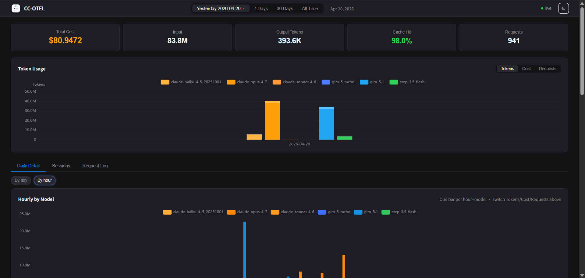
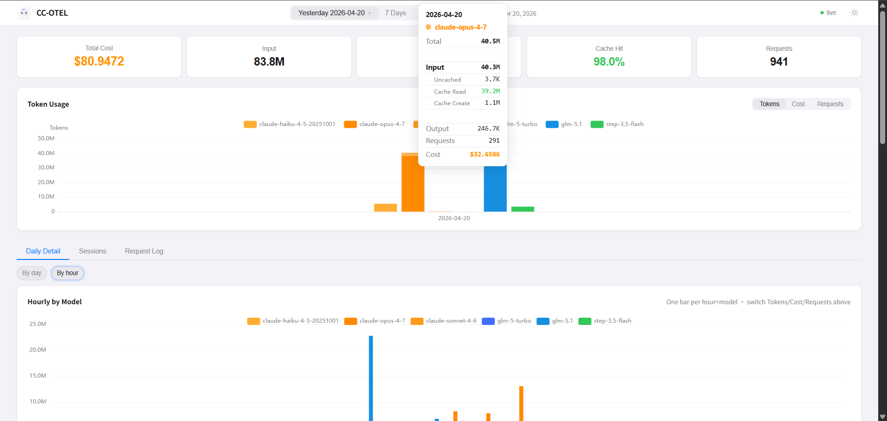

[Chinese Documentation](./README.md)

[](https://github.com/young1lin/cc-otel)
[](https://golang.org/)
[](LICENSE)
[](https://github.com/young1lin/cc-otel/releases)
[](https://codecov.io/gh/young1lin/cc-otel)
[](https://goreportcard.com/report/github.com/young1lin/cc-otel)
[](https://github.com/young1lin/cc-otel/actions/workflows/test.yml)
[](https://github.com/young1lin/cc-otel/releases)
[](https://github.com/young1lin/cc-otel/releases)

# CC-OTEL

Self-hosted multi-client token monitor: an OTLP receiver + Web dashboard for **Claude Code / Codex / opencode / DeepSeek Harness** token usage and cost. All clients share one cc-otel instance; the dashboard attributes every row by source.

## Docs

- [Design notes (why / how to change safely)](./docs/DESIGN_EN.md)
- [Changelog (version changes)](./CHANGELOG_EN.md)
- [Claude Code OTEL event reference](./docs/otel-events.md)

**Dark**


**Light**


## Why

Claude Code, Codex, opencode and DeepSeek Harness all have built-in OpenTelemetry support, but viewing the data requires setting up Grafana, Prometheus, or a third-party SaaS. **CC-OTEL** is a single binary that receives OTLP telemetry, stores it in SQLite, and serves a web dashboard -- no external dependencies, no complex setup.

## Architecture

```
Claude Code / Codex ──OTLP gRPC(:4317)──┐
                                        ├──> cc-otel ──> SQLite
opencode / DSH ──OTLP/HTTP(:4318)───────┘        |
                                            Web UI <── Browser (localhost:8899)
```

## Features

- **Multi-client ingestion** -- Claude Code / Codex / opencode / DeepSeek Harness on one instance, attributed by source (see table below)
- **Dual OTLP transports** -- gRPC (`:4317`) + OTLP/HTTP (`:4318`), one ingestion path
- **Web dashboard** -- token usage, cost breakdown, cache hit rate, per-model stats
- **KPI breakdowns** -- click any KPI card for model-level detail
- **Live updates** -- SSE push when new data arrives
- **Dark / light theme** -- auto-detects system preference
- **Date ranges** -- Today, 7 Days, 30 Days, All Time, or custom date picker
- **Chart switching** -- Tokens, Cost, Requests views
- **Session tracking** -- per-session cost and token aggregation
- **Token rate chart (Rate)** -- per-model Out/Total tok/s over time (weighted / average, 5–60 min buckets; up to 7 days)
- **Online database import** -- merge an uploaded `.db` into the running primary DB, no downtime, additive-only
- **Pre-aggregation table** -- query latency < 3ms, handles millions of rows
- **Single binary** -- `go:embed` bundles the web UI, zero runtime dependencies
- **Cross-platform** -- Windows, macOS, Linux

## Supported Clients

| Client | Transport / Port | Setup | Docs |
|--------|-----------------|-------|------|
| **Claude Code** | OTLP gRPC `:4317` | OTEL env vars in `~/.claude/settings.json` (`/cc-otel:setup` does it for you) | [below](#configure-clients) |
| **Codex CLI** | OTLP gRPC `:4317` | `[otel]` block in `~/.codex/config.toml` | [below](#codex-cli) |
| **opencode** | OTLP/HTTP `:4318` | toggle in `opencode.jsonc` + `OTEL_EXPORTER_OTLP_ENDPOINT` env var | [below](#opencode) |
| **DeepSeek Harness** | OTLP/HTTP `:4318` | `DSH_TELEMETRY_*` env vars or `cordis.patch.yml` | [below](#deepseek-harness-dsh) |

- Every client shares the same cc-otel instance; the request log's **Source column** labels each row.
- Codex reports a fundamentally different ledger, so it routes to its own `codex_*` tables and `?source=codex` tab; all other clients are normalized into the Claude Code event shape and share the **All Clients** main view.
- Debugging a new client: `go run ./tools/otlp_dump` (both transports, prints without storing; for AI SDK spans it also prints the `would_store_api_request` cc-otel would derive).

## Install

### Claude Code Plugin (recommended)

```bash
/plugin marketplace add young1lin/claude-token-monitor
/plugin install cc-otel@claude-token-monitor
/reload-plugins
/cc-otel:setup
```

### Available Commands

| Command | Description |
|---------|-------------|
| `/cc-otel:setup` | Download binary, configure OTEL env vars, start service |
| `/cc-otel:start` | Start background daemon |
| `/cc-otel:stop` | Stop daemon |
| `/cc-otel:status` | Show service status + today's cost summary |
| `/cc-otel:open` | Open Web dashboard in browser |
| `/cc-otel:report [today\|7d\|30d\|all]` | Generate cost report |

### From Source

```bash
# Linux / macOS
go build -o cc-otel ./cmd/cc-otel/

# Windows
go build -o cc-otel.exe ./cmd/cc-otel/
```

### From Release

Download the binary for your platform from [Releases](https://github.com/young1lin/cc-otel/releases).

### Install to ~/.cc-otel/

```bash
cc-otel install    # copies binary to ~/.cc-otel/ (all platforms)
cc-otel init       # generates default config in the same directory
```

> **Upgrading from an older version (~/.claude/cc-otel/ → ~/.cc-otel/)**: as of v0.1.0 the install
> directory is independent of Claude Code. The new binary **automatically** moves the whole
> `~/.claude/cc-otel/` directory (config, database, logs) to `~/.cc-otel/` on first run, provided the
> old daemon has been stopped (if files are locked the migration is skipped and retried next run —
> data is never stranded). Upgrade: `cc-otel stop` (old binary) → new binary `cc-otel install && cc-otel start`.

## Run

```bash
cc-otel start      # background daemon
cc-otel status     # show version, PID, ports, today's stats
cc-otel stop       # stop daemon
cc-otel serve      # foreground (debugging)
cc-otel -v         # print version
cc-otel cleanup    # delete old data per retention_days
```

Open the dashboard: **http://localhost:8899/**

## How It Works

### What is OpenTelemetry?

[OpenTelemetry](https://opentelemetry.io/) (OTEL) is the CNCF observability standard that unifies three telemetry signals:

- **Metrics** -- time-series counters (tokens, cost, request count, ...)
- **Logs / Events** -- structured events (every API request, user prompt, tool result)
- **Traces** -- distributed tracing (beta in Claude Code 0.2.x+)

Claude Code ships an embedded OTEL SDK and exports these signals over **OTLP** (OpenTelemetry Protocol) to any compatible backend. CC-OTEL is a lightweight OTLP backend purpose-built for Claude Code.

### Data Flow

```
┌─────────────────┐   OTLP/gRPC :4317 ┌──────────────────────┐    ┌────────────────────────┐
│  Claude Code    │ ────────────────▶ │  cc-otel             │───▶│  SQLite                │
│  Codex CLI      │                   │  · gRPC :4317        │    │  · api_requests        │
└─────────────────┘                   │  · OTLP/HTTP :4318   │    │  · codex_api_requests  │
┌─────────────────┐   OTLP/HTTP :4318 │    (same Export)     │    │  · daily_model_agg     │
│  opencode       │ ────────────────▶ │  · LogsService       │    │  · codex_daily_model…  │
│  DeepSeek Harness│                  │  · MetricsService    │    └──────────┬─────────────┘
│  (OTEL SDK)     │                   │  · TraceService      │               │
└─────────────────┘                   └──────────┬───────────┘               │
                                                 │ Notify()                  │
                                                 ▼                           │
                                      ┌──────────────────────┐               │
                                      │  Web UI (:8899)      │◀──────────────┘
                                      │  · REST API          │   query
                                      │  · SSE /api/events   │───┐
                                      └──────────────────────┘   │ push
                                                                 ▼
                                                          ┌────────────┐
                                                          │  Browser   │
                                                          └────────────┘
```

### Three Stages

**1. Receive (`internal/receiver/`)**

An embedded gRPC server implementing the official OTLP `LogsService`, `MetricsService`, and `TraceService`:

- Each `claude_code.api_request` log event carries the full detail of one API call (model, tokens, cost, duration, `session.id`, `user.id`, etc. as resource + record attributes) and is written to the `api_requests` table.
- `claude_code.token.usage`, `claude_code.cost.usage` and other metrics are intentionally **not persisted** (redundant with the `api_request` log); the gRPC call is still accepted so clients don't error out.
- Trace spans are mined for `ttft_ms` and back-filled into the matching `api_requests` / `codex_api_requests` rows.
- The `raw_otlp_events` / `codex_raw_otlp_events` tables remain in the schema for compatibility with existing backfill tools but **no new rows are written**.

**2. Store (`internal/db/`)**

A single-file SQLite database (WAL mode + `busy_timeout`):

- `api_requests` / `codex_api_requests` -- one row per API call, the finest-grained fact table.
- `daily_model_agg` / `codex_daily_model_agg` -- pre-aggregated on the insert path by (date × model); all chart / Daily Detail queries hit these tables (latency < 3 ms).
- `raw_otlp_events` / `codex_raw_otlp_events` -- legacy raw-event tables (now write-frozen) + background sweepers: `raw_ttl_days` (default 5d) prunes raw tables hourly; the rest of the detail tables are governed by `retention_days` (default 90d).

Token accounting follows Anthropic's [Prompt caching spec](https://docs.anthropic.com/en/docs/build-with-claude/prompt-caching) precisely: total input side = `input_tokens` + `cache_read_tokens` + `cache_creation_tokens`, surfaced in the UI as three columns (Uncached / Cache Read / Cache Create).

**3. Serve (`internal/api/` + `internal/web/`)**

- REST API: `/api/dashboard`, `/api/daily`, `/api/sessions`, `/api/rate`, `/api/session/rate`, `/api/status`, ...
- SSE: `/api/events` -- every successful insert calls `Broker.Notify()`, which pushes a Server-Sent Event to the browser so charts refresh without polling
- Static assets: bundled with `go:embed` by default; set `CC_OTEL_STATIC_DIR` during local development to serve directly from disk and skip recompilation

### Dual transports: gRPC `:4317` + OTLP/HTTP `:4318`

Both transports run the **same** Export ingestion logic (`internal/receiver/http.go` is a protocol shim, not a second ingestion path) — source routing, cost recompute, dedup, and SSE are identical:

- **gRPC (`:4317`)** -- Claude Code, Codex. Claude Code's gRPC exporter path is the most battle-tested, the protobuf wire format is ~40% smaller than JSON, and HTTP/2 multiplexing keeps export latency low.
- **OTLP/HTTP (`:4318`)** -- clients that cannot speak gRPC: opencode and other Vercel AI SDK apps, DeepSeek Harness (gzip requests are decompressed transparently).

The shim answers per the OTLP spec: it replies in the encoding the client sent (JSON in → JSON out) and **never returns 2xx for data it did not store** — an exporter treats 2xx as delivered and drops the batch.

## Configure Clients

Claude Code must export OTLP via gRPC to CC-OTEL. Add these env vars to `~/.claude/settings.json` under `"env"`:

```json
{
  "env": {
    "CLAUDE_CODE_ENABLE_TELEMETRY": "1",
    "OTEL_EXPORTER_OTLP_PROTOCOL": "grpc",
    "OTEL_EXPORTER_OTLP_ENDPOINT": "http://localhost:4317",
    "OTEL_METRICS_EXPORTER": "otlp",
    "OTEL_LOGS_EXPORTER": "otlp",
    "no_proxy": "localhost,127.0.0.1"
  }
}
```

> **Important**: only add/update the OTEL keys -- do not overwrite your existing settings. The port should match `otel_port` in `cc-otel.yaml`.

> **⚠️ Proxy users — required**: If you have `http_proxy` / `https_proxy` set (e.g. Clash, V2Ray, or corporate proxies), you **must** also set `no_proxy` to exclude localhost, **otherwise telemetry data will not be received at all**. The OTEL gRPC SDK routes traffic to `localhost:4317` through the proxy, which silently drops the gRPC connection — cc-otel receives nothing. Setting `"no_proxy": "localhost,127.0.0.1"` forces the OTEL exporter to connect directly. `/cc-otel:setup` adds this automatically.

### Codex CLI Setup

cc-otel also supports receiving OpenTelemetry telemetry from OpenAI Codex CLI. Codex shares the same OTLP gRPC port (`:4317`) with Claude Code. cc-otel auto-detects the source via the OTLP Resource `service.name` attribute and routes data to separate `codex_*` tables.

Add to `~/.codex/config.toml` (backup first, then append — do not overwrite existing config):

```toml
[otel]
environment = "dev"
exporter.otlp-grpc.endpoint = "http://localhost:4317"
trace-exporter.otlp-grpc.endpoint = "http://localhost:4317"
metrics-exporter.otlp-grpc.endpoint = "http://localhost:4317"
```

Start Codex and use normally. Open the dashboard (`http://localhost:8899/?source=codex`) to view Codex usage data. **Codex does not report `cost_usd`** — cc-otel computes it locally from the per-token price table and writes the result into `codex_api_requests.cost_usd`, so the Cost KPI matches the Claude tab.

### opencode

opencode is built on the Vercel AI SDK, which reports token usage on GenAI **spans** rather than log events. cc-otel reshapes the usage span into the standard `api_request` shape, so opencode data lands in the **All Clients** main view (no separate tab); the request log's Source column reads `opencode`.

opencode speaks **OTLP/HTTP (`:4318`)** — pointing it at `:4317` will not work. Two steps:

**1. Enable telemetry** (`~/.config/opencode/opencode.jsonc`; on Windows `%USERPROFILE%\.config\opencode\opencode.jsonc`):

```jsonc
{
  "$schema": "https://opencode.ai/config.json",
  "experimental": {
    "openTelemetry": true
  }
}
```

**2. Point it at cc-otel** (standard OTel env var, persisted for the user):

```powershell
# Windows
[Environment]::SetEnvironmentVariable('OTEL_EXPORTER_OTLP_ENDPOINT','http://localhost:4318','User')
```

```bash
# macOS / Linux — add to your shell profile
export OTEL_EXPORTER_OTLP_ENDPOINT=http://localhost:4318
```

> **Use the BASE url, not the full signal path.** The SDK appends `/v1/traces` itself; setting `http://localhost:4318/v1/traces` makes it request `/v1/traces/v1/traces`, which 404s.

Restart opencode and run one model reply; the dashboard's Source column should show `opencode`.

**Differences from Claude Code**:

- opencode **reports no `cost_usd`** — cc-otel always recomputes from the local pricing table. Driving Claude models through opencode requires adding the Claude rows yourself (the bundled seed intentionally ships none), or those rows stay at $0.
- Usage is taken from the leaf span only (`ai.streamText.doStream` / `ai.generateText.doGenerate`); the parent span carries usage too and is ignored — counting both would double every request.
- `request_id` is the hex span id, so exporter retries collapse onto one row.

### DeepSeek Harness (DSH)

cc-otel also receives [DeepSeek Harness](https://github.com/deepseek-ai/deepseek-harness) session telemetry. Two things differ from Claude Code / Codex:

- **It speaks OTLP/HTTP (`:4318`), not gRPC.** DSH uses the OTel JS SDK's HTTP log exporter; the endpoint must be the **full logs path** `/v1/logs`, not just host:port.
- **DSH exports its whole session ledger** (every user/assistant message, tool call, tool result). cc-otel turns only the usage-bearing `assistant/message` records into `api_requests` rows; every other record is **dropped, never stored** — in `FULL` mode they contain complete prompts, command output, and file contents.

DSH's `dsh-base` bundle already ships the `session-telemetry-otel` line, `DISABLED` by default and pointed at DeepSeek's official collector. Two ways to switch it to a local cc-otel:

**Option 1: environment variables (temporary, one shell)**

```powershell
$env:DSH_TELEMETRY_MODE = "FULL"
$env:DSH_TELEMETRY_OTLP_URL = "http://localhost:4318/v1/logs"
npx @deepseek-ai/dsh web
```

**Option 2: `$DSH_HOME/cordis.patch.yml` (permanent, recommended)**

`$DSH_HOME` defaults to `~/.dsh`. Append this top-level record to that file (do **not** put it inside the existing `insert:` list — it overrides the bundle line by `id`, it is not an insert):

```yaml
- id: session-telemetry-otel
  name: '@deepseek-ai/dsh-session-telemetry-otel'
  config:
    mode: !!js process.env.DSH_TELEMETRY_MODE || 'FULL'
    shutdownTimeoutMillis: 3000
    exporter:
      url: !!js process.env.DSH_TELEMETRY_OTLP_URL ?? 'http://localhost:4318/v1/logs'
      compression: gzip
      timeoutMillis: 1000
    processor:
      scheduledDelayMillis: 10000
      maxQueueSize: 2048
      maxExportBatchSize: 2048
      exportTimeoutMillis: 1500
```

> **Note**: the patch is a **whole-key replacement**, not a deep merge — every field the bundle sets must be restated here, or it silently falls back to the plugin default. Keep `name`: if DSH renames the package, the patch skips with a warning instead of silently sending telemetry back to the official collector. The two `!!js` expressions keep env-var overrides working (e.g. `DSH_TELEMETRY_OTLP_URL=http://localhost:14318/v1/logs` temporarily points at a dev instance).

Verify the composed config with `npx @deepseek-ai/dsh web --dump-config`: exactly **one** `id: session-telemetry-otel` line should appear, with the local URL.

Start DSH and chat normally; the dashboard's (`http://localhost:8899`) Source column shows `deepseek-harness`.

**Troubleshooting** (ordered by frequency):

| Symptom | Cause |
|---------|-------|
| No data at all | `mode` defaults to `DISABLED`; config is read at plugin load — **restart dsh** after changing it |
| No data despite correct config | any non-empty `DSH_TELEMETRY_DISABLED` (including `0` / `false`) vetoes everything |
| Rows appear after a few seconds | batch processor `scheduledDelayMillis: 10000` — up to 10s export delay |
| Only recent rows, no history | DSH hands over from the live boundary where telemetry was enabled; earlier history is not replayed |
| Cost is $0 | no pricing entry for that model (e.g. `glm-5.x` not yet catalogued) — add it in the Pricing Table, then ↻ 重算历史 |
| Server logs `malformed OTLP payload` | cc-otel too old: DSH always sends `compression: gzip`; decompression needs v0.1.0+ |

> **⚠️ Privacy**: `mode: FULL` ships your complete session content (prompts, tool output, file contents) to the endpoint above. cc-otel stores only tokens and cost — no body is persisted (`raw_otlp_events` stays empty) — but the data does traverse the connection; keep it pointed at localhost. Use `mode: FEEDBACK_ONLY` to report only when you run `/feedback`.

## Pricing table & non-Claude cost recompute

cc-otel ships with a price snapshot derived from [BerriAI/litellm](https://github.com/BerriAI/litellm) (GPT / GLM / DeepSeek / Kimi / Qwen / …). The first start seeds it into the `model_pricing` table. **The price table is purely manual now — there is no scheduled remote refresh.** Lookups follow this priority:

1. **`pricing:` in `cc-otel.yaml`** (user override, highest)
2. **SQLite `model_pricing` table** (canonical store, survives restarts)

To change a price: open the Web UI (top-right `live` → Status popup → **Pricing Table**) and add/edit/delete rows directly — saves take effect immediately. Click the in-row 💡 to look up a single model on OpenRouter on demand and prefill its prices. After a price change, click ↻ 重算历史 to trigger a server-side full recompute (status tracked, survives page refresh).

Recompute follows a single rule:

- `model` starts with `claude-` (case-insensitive) → trust the `cost_usd` Claude Code already reported (Anthropic owns the canonical Claude prices).
- Everything else → recompute locally from token counts.

This corrects two situations: Codex (`gpt-5-codex`, etc.) records that previously stored `cost_usd = 0`, and GLM/DeepSeek/Kimi traffic that flowed through an Anthropic-compatible reverse proxy and was therefore priced like Sonnet/Opus.

Debug: `GET /api/pricing/lookup?model=glm-4.6` shows the resolved entry and match strategy. The Status popup's **Pricing Table** row shows the last recompute result.

Backfilling history:

```bash
# dry-run first
go run ./tools/recompute_cost --db ~/.cc-otel/cc-otel.db --table both
# review the per-model delta, then apply
go run ./tools/recompute_cost --db ~/.cc-otel/cc-otel.db --table both --apply
```

## Online database import

Merge a `.db` file into the live primary database **without stopping the process or replacing any file**. The target stays online in WAL mode; the uploaded database is opened read-only and never attached to the writable connection. The merge is additive only — only rows missing from the target are inserted, duplicates keep the target's version, and an import ledger makes re-upload / retry safe with no double writes.

Click **Import database** at the top of the Web UI and pick a `.db` file: schema precheck → preview new / duplicate rows → confirm → live progress → result. Endpoints: `/api/import{,/inspect,/start,/status}`.

> Handy for merging another machine's `cc-otel.db` in — no downtime, no CLI merge tool. Single-file limit 2 GB; compatibility-only tables like `codex_events` are skipped automatically.

## Configuration

CC-OTEL resolves its data directory in this order (see `defaultDataDir` in `internal/config/config.go`):

1. **`./bin/`** -- if the executable lives in a directory named `bin` (dev mode).
2. **`~/.cc-otel/`** -- otherwise this directory is used (auto-created if missing); on first run it automatically migrates a pre-v0.1.0 `~/.claude/cc-otel/` install wholesale.
3. **`.`** -- final fallback, used only when the home directory can't be resolved.

All files (binary, config, DB, PID, log) live in the same directory:

```
~/.cc-otel/
├── cc-otel(.exe)    # executable
├── cc-otel.yaml     # config
├── cc-otel.db       # SQLite database
├── cc-otel.pid      # daemon PID
└── cc-otel.log      # log file
```

Environment variable overrides (highest priority):

| Variable | Description | Default |
|----------|-------------|---------|
| `CC_OTEL_OTEL_PORT` | OTLP gRPC receiver port | `4317` |
| `CC_OTEL_OTLP_HTTP_PORT` | OTLP/HTTP receiver port (`0` disables) | `4318` |
| `CC_OTEL_WEB_PORT` | Web UI port | `8899` |
| `CC_OTEL_DB_PATH` | SQLite database path | `~/.cc-otel/cc-otel.db` |

### Data Retention

cc-otel runs two independent cleanups:

```yaml
retention_days: 90    # cap on full-detail tables (api_requests / events / *_events / *_agg etc.) in days; 0 = keep forever
raw_ttl_days: 5       # cap on raw_otlp_events / codex_raw_otlp_events in days (now write-frozen, this just trims old rows); 0 = keep forever
```

- `retention_days` (default 90) is consumed by `cc-otel cleanup` and the periodic prune.
- `raw_ttl_days` (default 5) is consumed by a separate hourly sweeper, because the raw tables dominate disk usage.

## Web UI


### Status Indicator

Top-right green dot + `live` indicates the SSE stream is connected. Click to open the **Server Status** panel showing DB health, OTLP receiver status, and endpoints.

### KPI Breakdowns

Click any KPI card (Cost, Input, Output, Cache Hit, Requests) to see a per-model breakdown.

### Panels

| Panel | Description |
|-------|-------------|
| **Daily Detail** | Per-day / per-hour tables; Intraday per-bucket bar chart on single-day ranges (5 / 10 / 15 / 30 / 60 min, up to 7 days) |
| **Sessions** | Per-session Cost / Token aggregates |
| **Request Log** | Per-model duration and **Out tok/s (avg / weighted)** summary; per-request list with TTFT |
| **Rate** | Per-model **Token Rate over Time** line chart; Weighted / Avg, Output / Total tok/s, 5 / 15 / 30 / 60 min buckets; click legend to solo one model (**All models** to restore) |

`duration_ms` is API request time only (excludes local tool execution), so tok/s reflects model output throughput. Multi-day views break lines at calendar-day boundaries; switching the date range defaults to **Today → 5 min**, **multi-day → 30 min** (overridable).

## Update

### Update Plugin (commands and skills)

```bash
/plugin update cc-otel@claude-token-monitor
```

### Update Binary

`/cc-otel:setup` checks the installed version against the latest GitHub release and auto-updates if needed.

Or manually:

```bash
# Check current version
~/.cc-otel/cc-otel -v

# Force re-install
/cc-otel:setup --force
```

> **v0.1.0 upgrade note**: the install directory moved from `~/.claude/cc-otel/` to `~/.cc-otel/`. Stop the old
> daemon, then `install` + `start` with the new binary — the directory migration (database included) is
> automatic; see the [Install](#install-to-cc-otel) section.

## Development

```bash
make build       # build with version injection
make test        # run all tests
make coverage    # generate coverage report
make vet         # go vet
```

For frontend development without rebuilding:

```bash
CC_OTEL_STATIC_DIR=internal/web/static cc-otel serve
```

## License

[MIT](LICENSE)
